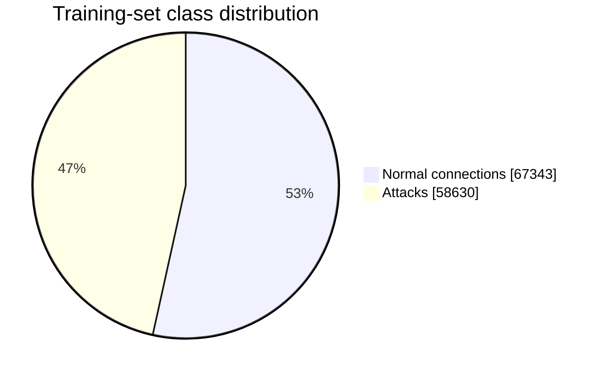

# Network Intrusion Detection with Machine Learning

This project trains and compares three machine-learning classifiers to detect intrusions in network connections using the **NSL-KDD** dataset. The task is framed as binary classification: `0` represents a normal connection and `1` represents an attack.

## Overview

```text
              Raw NSL-KDD Dataset
                       |
                       v
                 Data Loading
                       |
                       v
                 Preprocessing
      (label mapping, one-hot encoding,
         train/test column alignment)
                       |
                       v
              +--------+--------+
              |        |        |
              v        v        v
       Decision Tree  Random   XGBoost
                      Forest
              |        |        |
              +--------+--------+
                       |
                       v
                  Evaluation
     (accuracy, precision, recall, F1,
              confusion matrix)
```

## Dataset

The default input files are:

| Split | File | Connections | Normal | Attacks |
| --- | --- | ---: | ---: | ---: |
| Training | `data/raw/KDDTrain+.txt` | 125,973 | 67,343 (53.46%) | 58,630 (46.54%) |
| Test | `data/raw/KDDTest+.txt` | 22,544 | 9,711 (43.08%) | 12,833 (56.92%) |

Each record contains 41 network features, a label, and a difficulty level. The three categorical features (`protocol_type`, `service`, and `flag`) are one-hot encoded; with the supplied training data, this produces **122 model features**.



> These values are calculated from the dataset files included in this repository. They describe the data distribution, not model performance.

## Models

| Model | Main configuration |
| --- | --- |
| Decision Tree | `class_weight="balanced"`, `random_state=42` |
| Random Forest | 100 trees, `class_weight="balanced"`, parallel training enabled |
| XGBoost | 200 trees, maximum depth 6, learning rate 0.1, class weight derived from the training set |

## Results

The full pipeline was run against the included `KDDTrain+.txt` and `KDDTest+.txt` files with a decision threshold of `0.05`. The positive class is **attack**.

| Model | Accuracy | Attack precision | Attack recall | Attack F1 |
| --- | ---: | ---: | ---: | ---: |
| Decision Tree | 0.7906 | 0.9566 | 0.6623 | 0.7827 |
| Random Forest | **0.9249** | 0.9212 | **0.9493** | **0.9351** |
| XGBoost | 0.8378 | **0.9685** | 0.7390 | 0.8384 |

For this run, the Random Forest provides the best overall attack-detection balance. XGBoost has the highest precision, while its recall is lower at the configured threshold.

## Installation

Requirements: Python 3.9+ and `pip`.

```bash
git clone <REPOSITORY_URL>
cd Intrusion-Detection-ML
python -m venv .venv
source .venv/bin/activate  # Windows: .venv\\Scripts\\activate
pip install -r requirements.txt
```

## Run the project

1. Make sure `KDDTrain+.txt` and `KDDTest+.txt` are available in `data/raw/`.
2. Preprocess the raw data. This creates the processed CSV files in `data/processed/`:

```bash
python src/preprocess.py
```

3. Train and evaluate all three models:

```bash
python main.py
```

For every model, the script prints accuracy, precision, recall, F1-score, a classification report, and a confusion matrix.

## Preprocessing pipeline

The preprocessing stage:

1. removes `difficulty_level`;
2. maps `normal` to `0` and every other label to `1`;
3. splits predictors from the target;
4. one-hot encodes `protocol_type`, `service`, and `flag`;
5. aligns test-set columns with training-set columns;
6. saves the resulting CSV files under `data/processed/`.

## Project structure

```text
.
├── data/
│   ├── raw/                 # Source NSL-KDD files
│   └── processed/           # Created during preprocessing
├── notebooks/
│   └── 01_exploration.ipynb # Initial data exploration
├── src/
│   ├── config.py            # File paths and column schema
│   ├── data_load.py         # Raw data loading
│   ├── preprocess.py        # Transformations and CSV export
│   ├── train.py             # Model definitions
│   └── evaluate.py          # Metrics and confusion matrix
├── main.py                  # Training/evaluation entry point
└── requirements.txt
```

## Limitations and next steps

- Add cross-validation and hyperparameter tuning.
- Save trained models and experiment metrics.
- Add ROC and precision-recall curves, plus feature importance plots.
- Test on recent traffic: NSL-KDD is a historical benchmark and may not represent current threats.
